# Architecture Microservices : Conception, Déploiement et Orchestration
## Travaux Pratiques (TP 3 à TP 7)

Ce dépôt regroupe l'implémentation complète des travaux pratiques (du **TP 3** au **TP 7**), les codes sources structurés en projets Maven / Spring Boot, ainsi que les captures d'écran attestant de la progression à 100% sur la plateforme **MLIAEdu**.

---

## Sommaire
- [TP 3 : Spring IoC & OCP - Stratégies d'Injection et Sélection d'Implémentations](#tp-3--spring-ioc--ocp---stratégies-dinjection-et-sélection-dimplémentations)
- [TP 4 : Hibernate et Persistance des Données](#tp-4--hibernate-et-persistance-des-données)
- [TP 5 : Intégration de Spring et Hibernate dans une Architecture Microservices](#tp-5--intégration-de-spring-et-hibernate-dans-une-architecture-microservices)
- [TP 6 : Spring Boot et Swagger - Documentation d'API Microservices](#tp-6--spring-boot-et-swagger---documentation-dapi-microservices)
- [TP 7 : JAX-RS / Jersey - Services Web RESTful Multi-Formats](#tp-7--jax-rs--jersey---services-web-restful-multi-formats)

---

## TP 3 : Spring IoC & OCP - Stratégies d'Injection et Sélection d'Implémentations

### Description
Ce TP explore les principes d'**Inversion de Contrôle (IoC)** et le principe **Open/Closed Principle (OCP)** du modèle SOLID. L'objectif est de concevoir une architecture logicielle capable d'intégrer de nouvelles implémentations de DAO sans modifier le code métier existant, en utilisant diverses stratégies de sélection :
1. **Stratégie `@Primary`** : Définition d'une implémentation par défaut.
2. **Stratégie `@Qualifier`** : Sélection explicite par identifiant de composant.
3. **Stratégie Dynamique par Fichier de Propriétés (`app.properties`)** : Chargement et injection configurables à chaud sans recompilation.
4. **Stratégie par Profils Spring (`@Profile`)** : Activation d'implémentations selon l'environnement (`dev`, `prod`).

### Arborescence du projet
`tp3-spring-ioc-ocp/`
- `dao/` : `IDao`, `DaoImpl`, `DaoImpl2`, `DaoFile`, `DaoApi`, `DaoImplProd`
- `metier/` : `IMetier`, `MetierImpl`, `MetierMultiple`
- `config/` : `AppConfig`, `DynamicDaoConfig`
- `resources/` : `app.properties`
- `test/` : `OcpSelectionTest`

### Captures d'écran importantes (TP 3)
| Étape | Description | Capture |
|---|---|---|
| **Étape 1** | Objectifs OCP & Inversion de Contrôle | 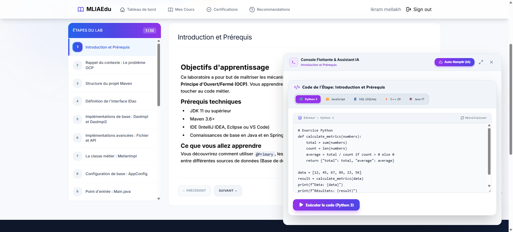 |
| **Étape 3** | Structure du Projet Maven & Dépendances | 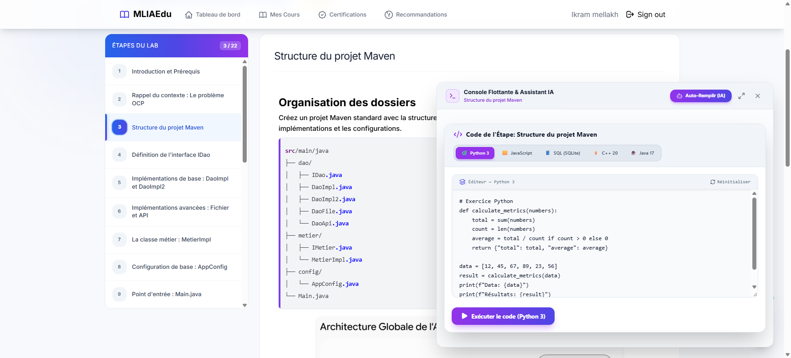 |
| **Étape 11** | Stratégie A : Utilisation de `@Primary` | 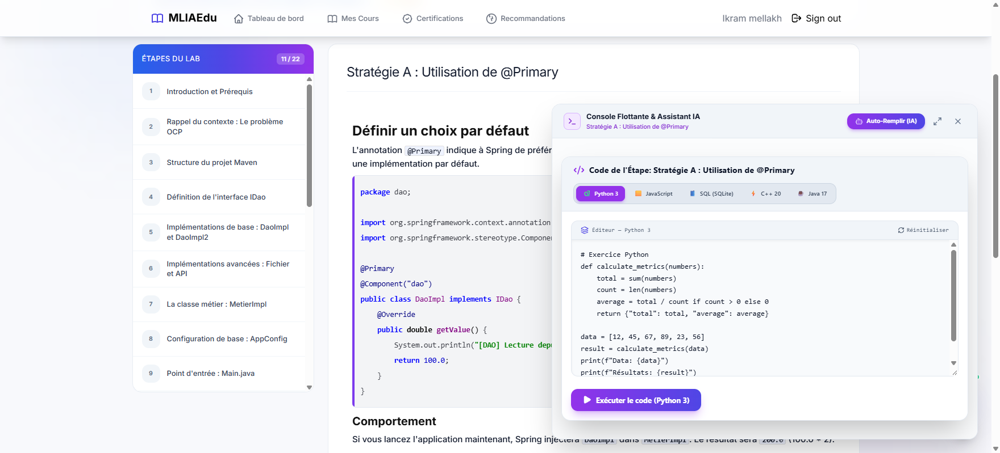 |
| **Étape 13** | Sélection Dynamique par `app.properties` | 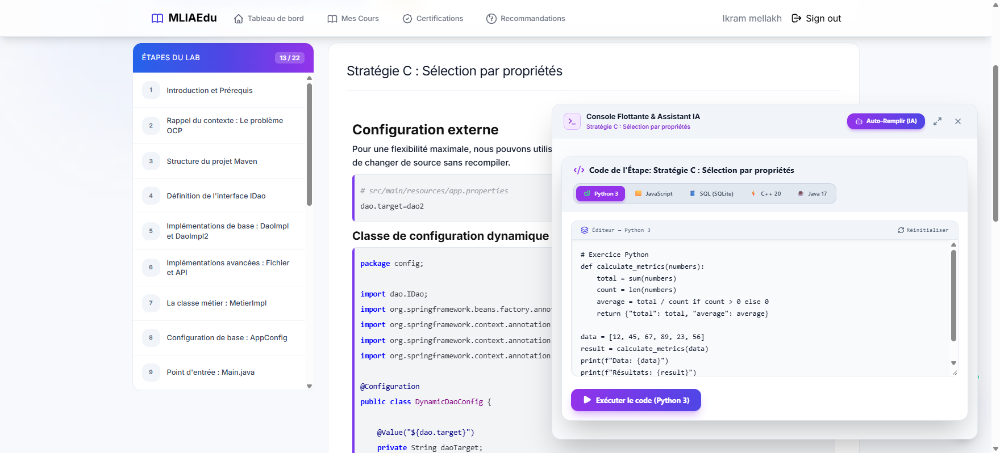 |
| **Étape 22** | Validation & Progression 100% | 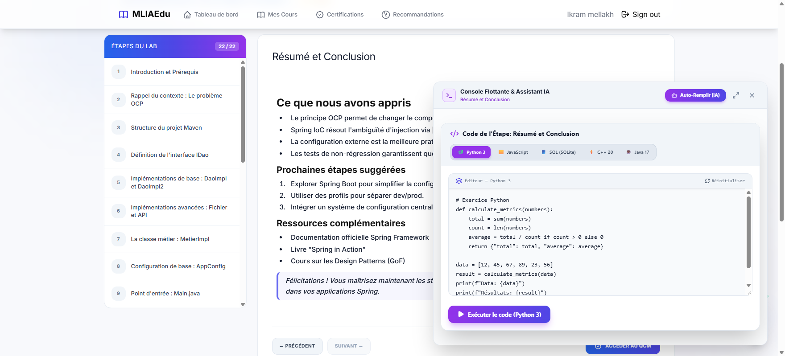 |

---

## TP 4 : Hibernate et Persistance des Données

### Description
Mise en place de la couche de persistance avec **Hibernate ORM** et le standard **JPA** pour la gestion d'un parc de machines réparties dans des salles informatiques.
- Modélisation relationnelle unidirectionnelle et bidirectionnelle avec `@OneToMany` et `@ManyToOne`.
- Gestion des sessions Hibernate et du cycle de vie des entités (`Transient`, `Persistent`, `Detached`).
- Implémentation d'une interface générique `IDao<T>` sécurisée avec transactions ACID et gestion des rollbacks.
- Écriture de requêtes HQL avancées (filtrage par marque).
- Validation unitaire avec **JUnit 5**.

### Arborescence du projet
`tp4-hibernate/`
- `entities/` : `Salle`, `Machine`
- `dao/` : `IDao`, `SalleDao`, `MachineDao`
- `services/` : `SalleService`, `MachineService`
- `util/` : `HibernateUtil`
- `resources/` : `hibernate.cfg.xml`

### Captures d'écran importantes (TP 4)
| Étape | Description | Capture |
|---|---|---|
| **Étape 1** | Introduction ORM & JPA | 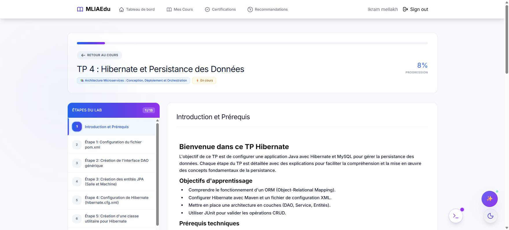 |
| **Étape 4** | Modélisation des Entités JPA (Salle & Machine) | 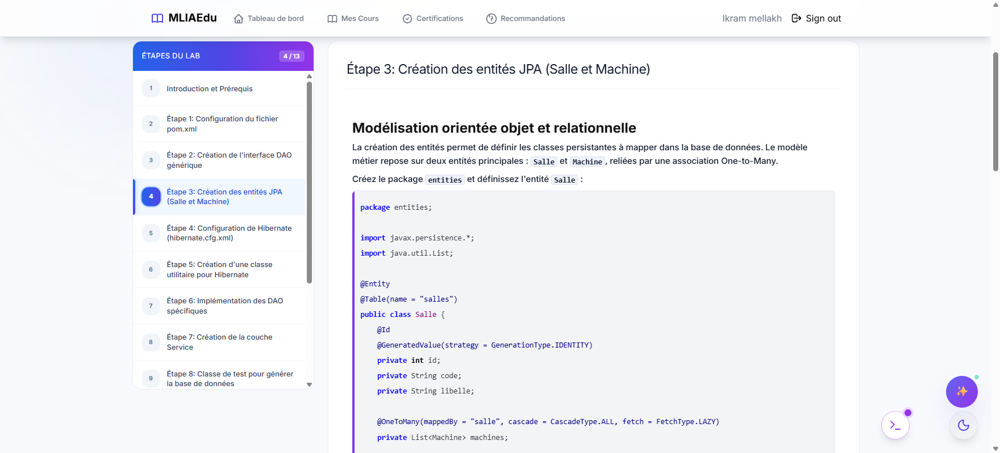 |
| **Étape 5** | Configuration Hibernate (`hibernate.cfg.xml`) | 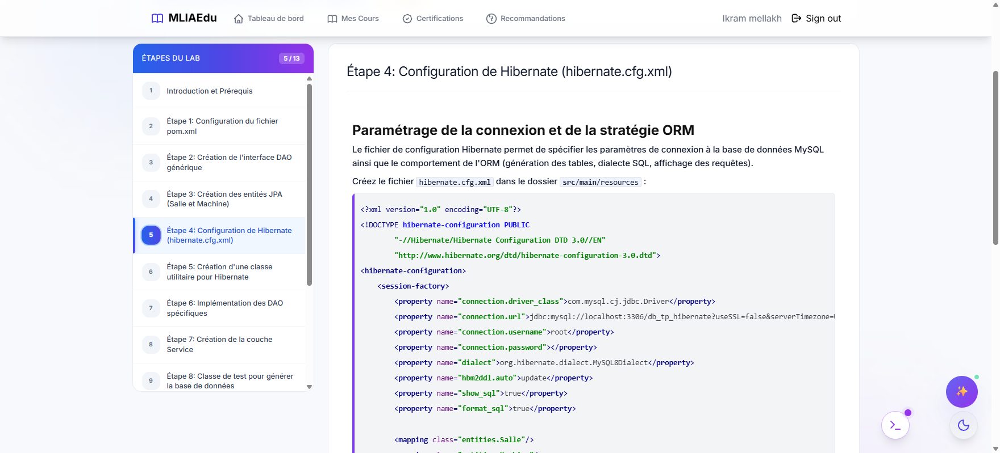 |
| **Étape 7** | Implémentation des DAO avec HQL | 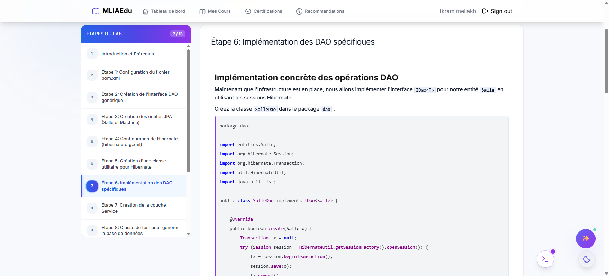 |
| **Étape 10** | Tests unitaires JUnit 5 | 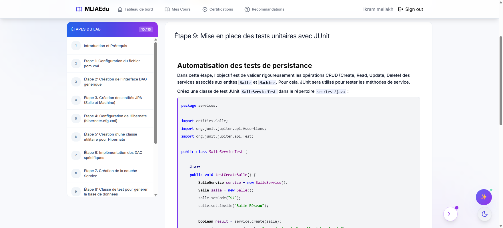 |
| **Étape 13** | Validation & Progression 100% | 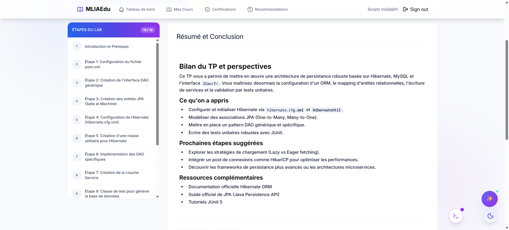 |

---

## TP 5 : Intégration de Spring et Hibernate dans une Architecture Microservices

### Description
Intégration transparente du framework **Spring** avec **Hibernate ORM** au sein d'un microservice de gestion de catalogue produits (`Product Microservice`) :
- Configuration 100% Java (sans XML) à l'aide de `@Configuration`, `@ComponentScan` et `LocalSessionFactoryBean`.
- Gestion déclarative des transactions avec `@EnableTransactionManagement` et `@Transactional`.
- Découplage de la source de données via un `DataSource` configurable depuis `application.properties`.
- Injection de dépendances propre entre Repository, Service et client d'exécution.

### Arborescence du projet
`tp5-spring-hibernate/`
- `entity/` : `Product`
- `dao/` : `IDao`, `ProductDaoImpl`
- `config/` : `HibernateConfig`, `TransactionConfig`, `AppConfig`
- `service/` : `ProductServiceImpl`
- `resources/` : `application.properties`

### Captures d'écran importantes (TP 5)
| Étape | Description | Capture |
|---|---|---|
| **Étape 1** | Architecture Microservices + Persistance | 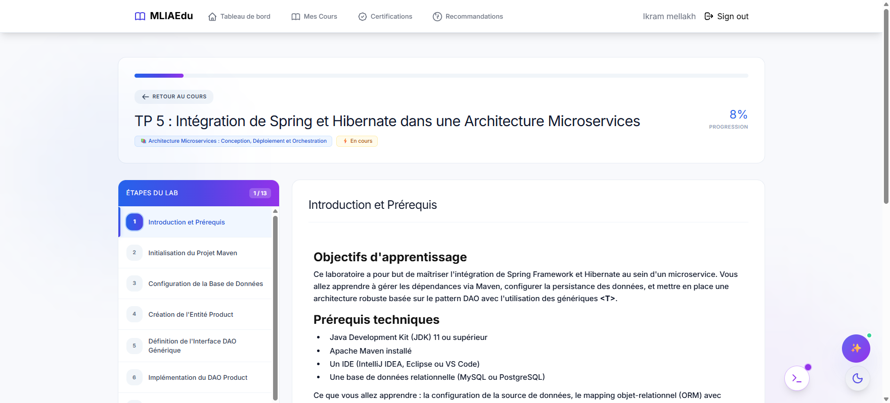 |
| **Étape 4** | Entité JPA `Product` | 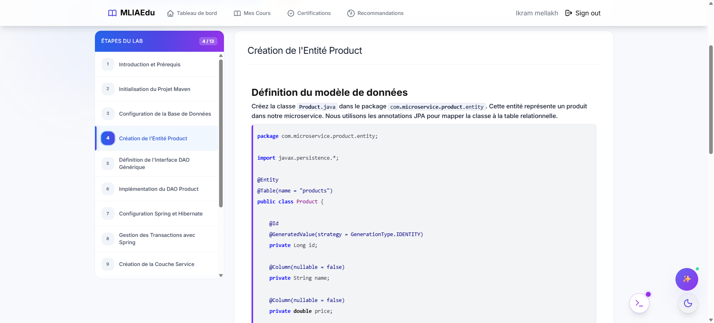 |
| **Étape 7** | Configuration Spring / Hibernate (`DataSource`) | 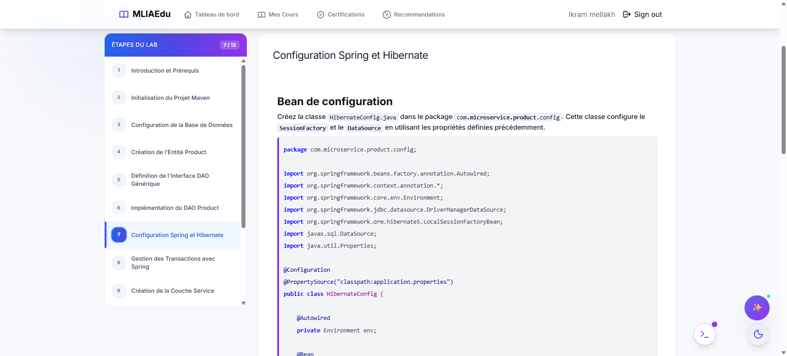 |
| **Étape 9** | Couche Service & `@Transactional` | 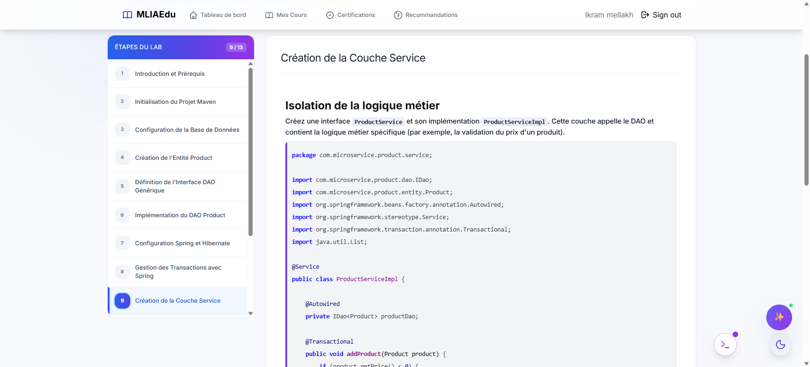 |
| **Étape 12** | Test d'exécution du Client (`MainApp`) | 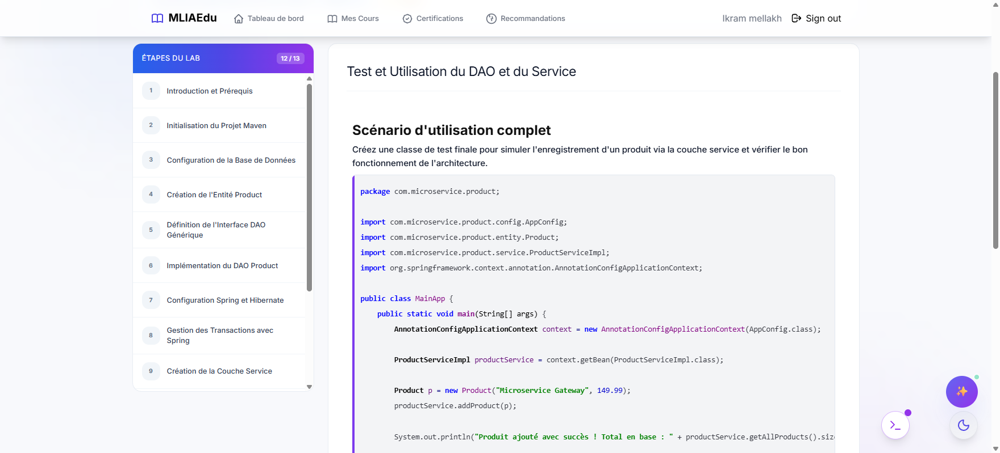 |
| **Étape 13** | Validation & Progression 100% | 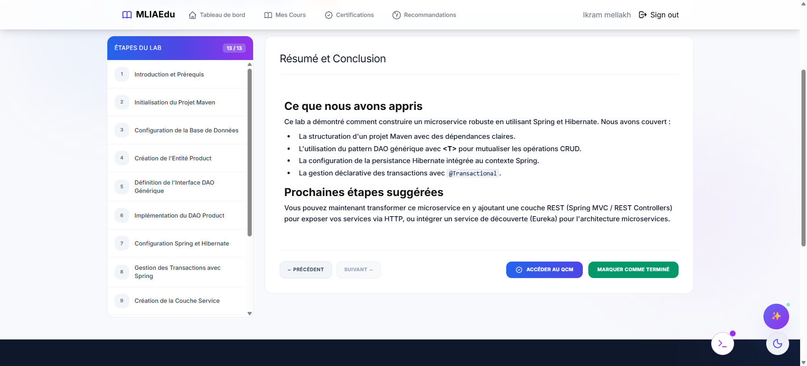 |

---

## TP 6 : Spring Boot et Swagger - Documentation d'API Microservices

### Description
Création d'un microservice complet de gestion des étudiants avec **Spring Boot 3** et auto-documentation interactive avec **OpenAPI / Swagger** (`springdoc-openapi`) :
- Création de l'entité JPA `Student` et du repository `StudentRepository` étendant `JpaRepository`.
- Méthode personnalisée avec agrégation HQL (`findNbrStudentByYear`).
- Contrôleur REST complet (`StudentController`) exposant les opérations CRUD.
- Documentation OpenAPI avec annotations `@Tag`, `@Operation`, `responses`.
- Tests unitaires de la couche contrôleur avec **Mockito** et **JUnit 5**.

### Arborescence du projet
`tp6-springboot-swagger/`
- `entities/` : `Student`
- `repositories/` : `StudentRepository`
- `services/` : `StudentService`
- `controllers/` : `StudentController`
- `test/` : `StudentControllerTest`

### Captures d'écran importantes (TP 6)
| Étape | Description | Capture |
|---|---|---|
| **Étape 1** | Présentation Spring Boot & Architecture Microservices | 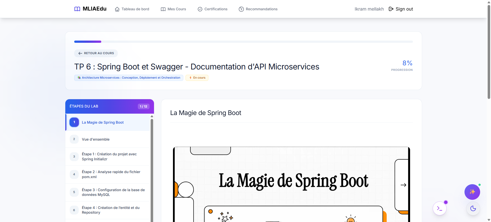 |
| **Étape 4** | Entité `Student` & Spring Data JPA | 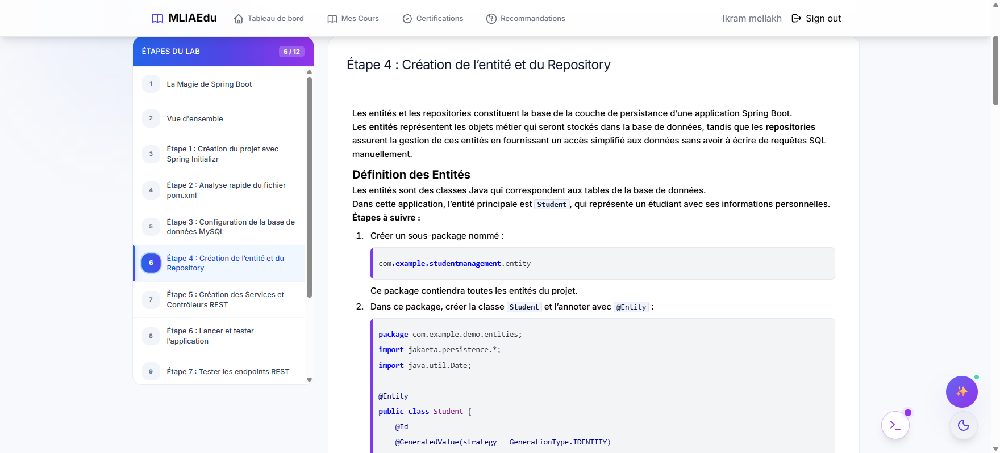 |
| **Étape 5** | Service & Contrôleur REST | 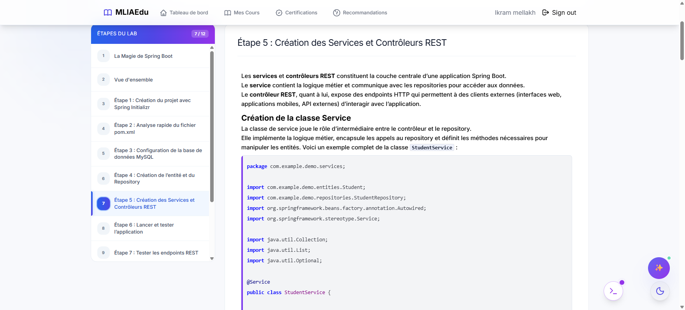 |
| **Étape 8** | Tests Unitaires avec Mockito | 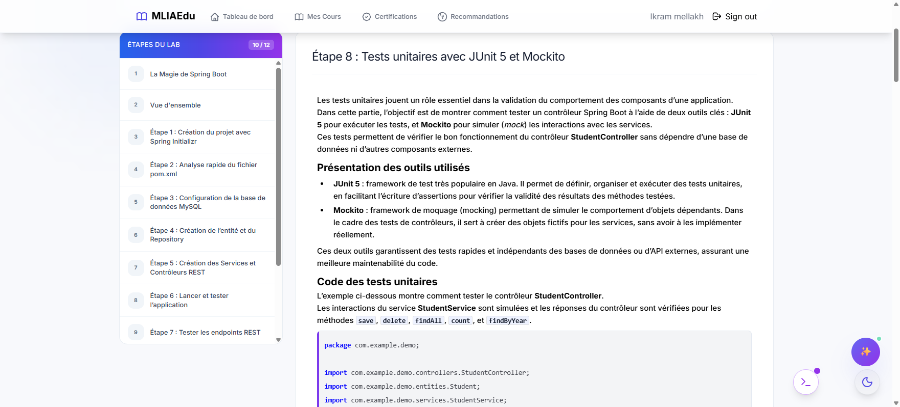 |
| **Étape 9** | Documentation OpenAPI / Swagger UI | 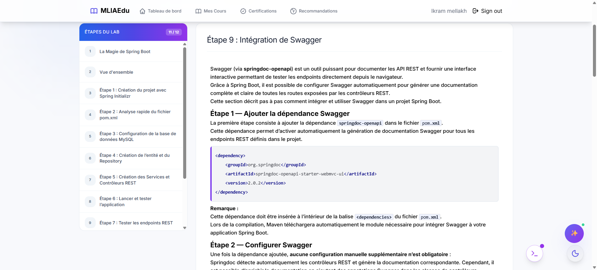 |
| **Étape 12** | Validation & Progression 100% | 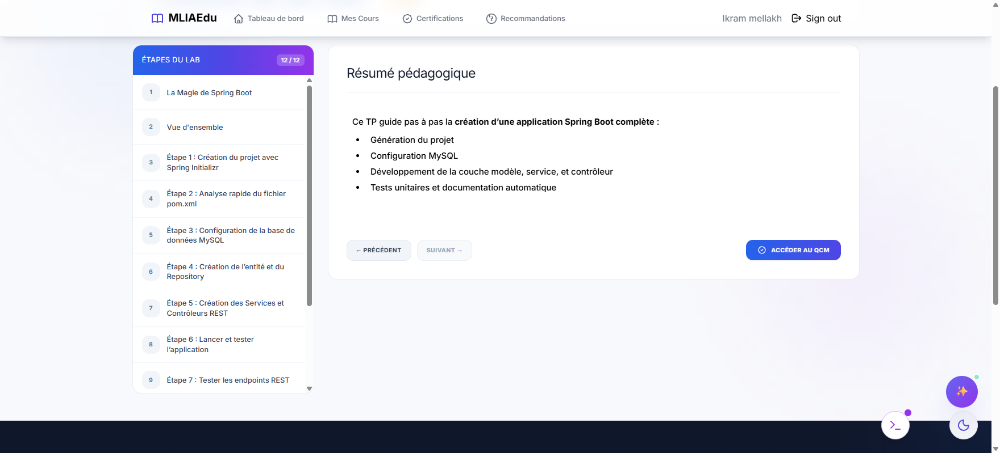 |

---

## TP 7 : JAX-RS / Jersey - Services Web RESTful Multi-Formats

### Description
Développement d'un microservice bancaire (`MsBanqueApplication`) utilisant la spécification standard **JAX-RS** implémentée par **Jersey** :
- Enregistrement de Jersey via `ResourceConfig`.
- Endpoints REST `@Path("/banque")` supportant la négociation de contenu multi-formats (**JSON** et **XML** via `@Produces` et `@Consumes`).
- Support de la sérialisation XML avec l'annotation JAXB `@XmlRootElement`.
- Opérations complètes : consultation de comptes, recherche par ID, création, modification et suppression.
- Base de données en mémoire **H2** avec chargement de données d'exemple via `CommandLineRunner`.

### Arborescence du projet
`tp7-jaxrs-jersey/`
- `entities/` : `Compte`
- `enums/` : `TypeCompte`
- `repositories/` : `CompteRepository`
- `config/` : `MyConfig` (`ResourceConfig`)
- `api/` : `CompteRestJaxRSAPI`
- `MsBanqueApplication.java`

### Captures d'écran importantes (TP 7)
| Étape | Description | Capture |
|---|---|---|
| **Étape 1** | Configuration Spring Initializr & Jersey | 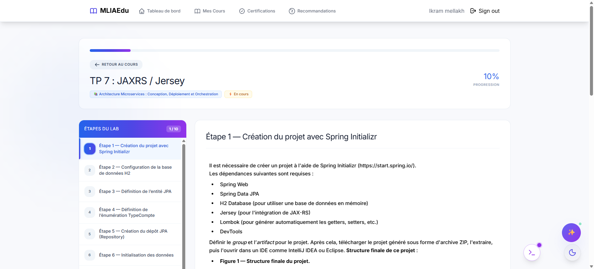 |
| **Étape 3** | Définition de l'Entité JPA `Compte` | 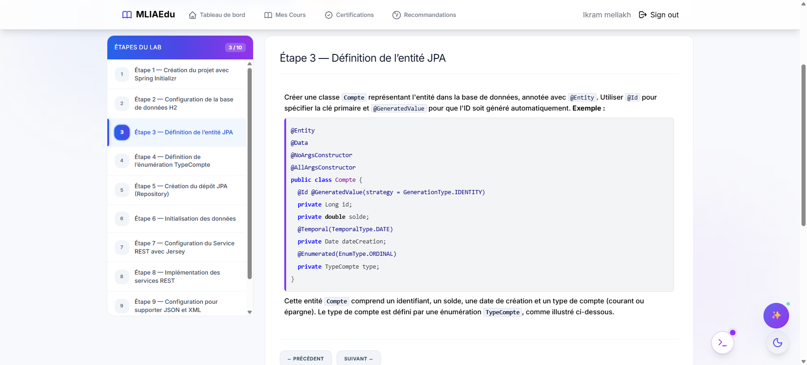 |
| **Étape 7** | Configuration Jersey (`ResourceConfig`) | 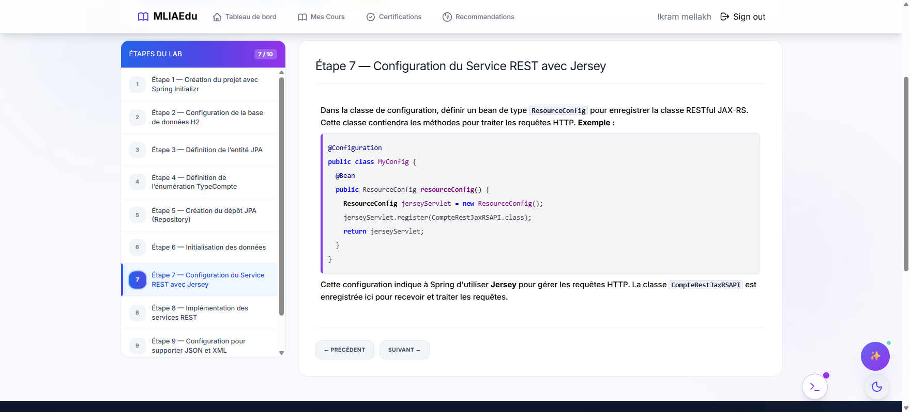 |
| **Étape 8** | Implémentation des Endpoints JAX-RS | 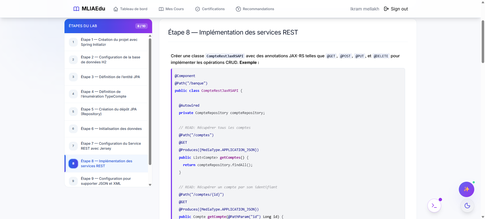 |
| **Étape 9** | Support Multi-Formats (JSON & XML) | 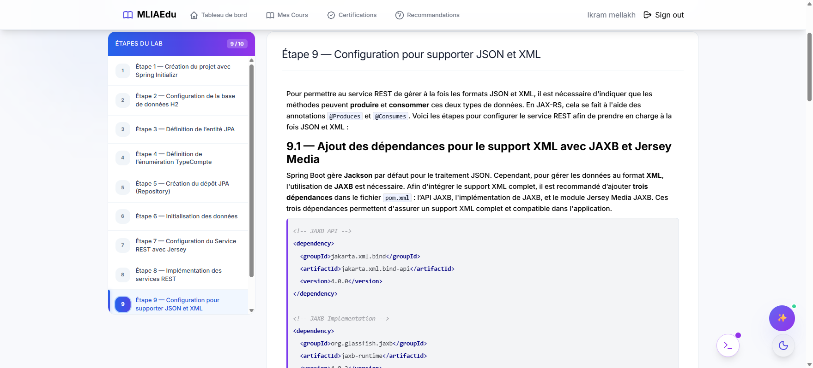 |
| **Étape 10** | Sérialisation XML `@XmlRootElement` & Progression 100% | 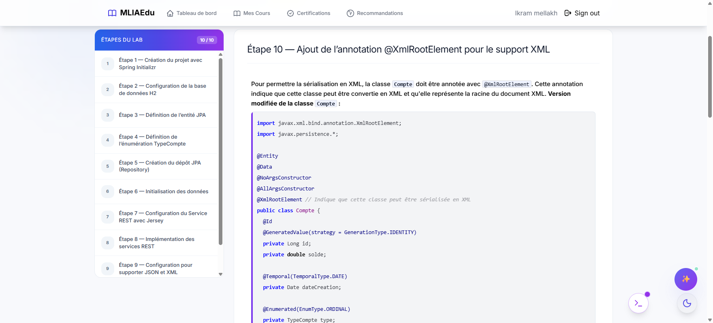 |

---
*Ce projet a été réalisé dans le cadre de la formation "Architecture Microservices : Conception, Déploiement et Orchestration" sur la plateforme MLIAEdu.*
